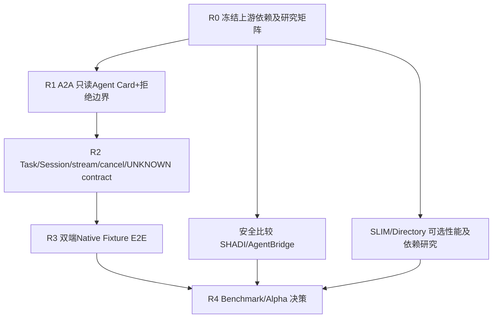

> **2026-10-26 附加研发工作线（不改变 R0–R4 顺序）**：GLM-5.3 承担 [Local Harness Interoperability LHI #79–#84](local/LHI_WORKSTREAM.md) 与 [ADR0005](adr/0005-local-harness-interop.md)：本机 Codex↔ZCode 被控新会话、真实主动 MCP 证据、将来单 Gateway Local Dispatcher。LHI 不是 #19 物理跨机 E2E，也不取代 GPT A2A 标准面/GLM 安全线。先保留已通过的双 Gateway loopback 基线，直达本机路由只能在独立 caller grant 与 fail-closed 测试验收后按功能开关开启。GLM 既有 #75 已 CLAIM，新 LHI 任务以不抢占现有工作树的方式领取。

# LAN Agent Mesh 2026-10-26 重大路线重规划：标准优先、保留可靠性核心

**状态**：指导性重规划（architecture and execution baseline），不是对生产部署、跨实体新窗口、模型/凭据调用的授权。原 [2026-10-26 双端计划](NEXT_PHASE_2026-10-26.md) 继续作为 **P2 Harness 实验基线**；本文件重新排列研发优先级，建立可以并行的 **Research/Interop R-track**。本文与 ADR0004 不改变任何旧实测 SHA/报告。

## 0. LLM / 开发者开始前必读

1. [ADR0004](adr/0004-standards-first-agent-interop.md) — 不可破坏的架构契约。
2. [技术吸收矩阵](research/INTEROP_LANDSCAPE_2026-10-26.md) — ADOPT/ADAPT/STUDY/DEFER/REJECT 及证据边界。
3. [LLM 任务交接规范](LLM_WORK_PACKETS.md) — 单任务执行、报告与 STOP。
4. [互操作与基准实验](research/INTEROP_EVALUATION.md) — 工程/安全/对照实验判据。
5. [历史 P2 双端计划](NEXT_PHASE_2026-10-26.md) 与 #15/#17/#18/#19 — 已验证的事实和未通过的实体门槛。

**禁止**：自动提升 native/tool/OS 权限、自动批准 pairing、上传本机用户配置/secret/IP、启动真实模型或付费云推理、执行非固定来源的原生二进制、未经审核替换已有 transport/数据库、默认暴露公网端口、关闭尚未完整验收的 Issue、把 Mac/Win 单机 fixture 称为真实跨机双向。

## 1. 决策

- **定位**：local-first heterogeneous Harness interoperability runtime，不再以「新 Agent-to-Agent 协议」为核心创新主张；核心研究为受限权限、原生会话映射、幂等与 UNKNOWN、双机器受控执行。
- **协议面**：**A2A v1.0** 作为新增、可选、默认关闭的北向 API；**MCP** 继续作为本机 Agent 主动调用 mesh_* 的工具面（本仓库已使用官方 SDK v2.4.0）；ACP/Codex App Server 留在 native 适配器侧。
- **数据/网络面**：内部 P0/P1 业务契约、libp2p Noise/Yamux、SQLite、私有目录、同机 Gateway 不迁移；AGNTCY SLIM/Directory、ANP 在研究实验后做可选后端评估。SHADI、AgentBridge、AgentLink、OpenAgents、AgentTorrent 做定点机制和公平对照。
- **权限面**：不能通过北向标准接口越过 Gateway scoped grant/native permission/OS/human decision。A2A 不应该自动扩大 Registry 能见范围。
- **迁移姿态**：先 Mock/单机 synthetic/fixture，后经用户批准新实体双端实验；所有新增可独立停用与回退，不改变之前主干默认行为。

## 2. 阶段图与依赖

R0 是 R1/R2/Security 适配的入口。R1 可与 Mac M1/Windows W1/W2 本机 fixture **并行**；R3 的实体窗口必须由用户明确协调，不因本路线写入 GitHub 而自动启动。R4 必须客观报告：比较系统不具备某能力时标 N/A 或不同威胁模型，不伪造同等覆盖。

## 3. 可直接派给 LLM 的工作包

### R0-A（Cross-platform / Research）：外部协议与供应链审核

- **输入**：ADR0004、研究矩阵、各上游规范及仓库固定 tag/commit。
- **范围**：逐一确认 A2A v1.0 最新规范对应官方 JS SDK API；核对 MCP v2.4.0 现状；AGNTCY Directory/SLIM/SHADI/AgentBridge/ANP 和开源对照项目 API、协议成熟度、license/SPDX、transitive 依赖、默认开放监听、是否需云/relay、Mac/Win 支持。未完成的保持 unknown。
- **交付**：`docs/research/upstream-locks.json`（schema: name,url,tagOrCommit,license,licenseEvidence,apiEvidence,platformEvidence,securityNotes,status,lastChecked；字段不明确允许 null）、每个关键项目至少一个源码/API 链接及变动评估；`docs/research/R0_DECISIONS.md` 每条 ADOPT/ADAPT/STUDY/DEFER 的原因和不可复用项。
- **测试**：JSON schema/URL/license sanity；不运行上游项目也可完成文档候选，但不得称 verified。
- **完成门槛**：必须有确定 pin 与许可证结论，才能添加第三方 runtime 依赖；R0 尚未签出不修改核心运行代码。

### R1-A（Mac-led，Windows review）：A2A 北向最小 Read-only Bridge

- **依赖**：R0 A2A SDK 锁定、#16 已有 scoped grants、ADR0004。
- **路径建议**：`packages/a2a-bridge/{package.json,src/*,test/*}` + `docs/A2A_BRIDGE.md`；不得悄然修改 `packages/protocol` wire 或 P1 transport。
- **功能**：feature flag 默认 false；loopback-only 明确绑定；独立认证和 scoped policy，在已授权的模拟网关 Agent Registry 中生成合法 v1.0 Agent Card；unknown/offline/revoked 私有 Agent 不暴露。未支持的 endpoints 明确返回规范允许的 unsupported/error。
- **拒绝负例**：无/错 token、跨 grant agentId、过期/撤销、伪造 caller、HTTP Origin/SSRF 风险、过大请求/卡片泄露。验证秘密不进 stdout/stderr/log。
- **验收**：官方 A2A 客户端与服务端建立 Mock 的 discovery 交互；未授权总是无私有信息；四组 CI；disabled 下旧测试与端口行为一致。
- **非目标**：公网 HTTP、push/webhook、stream 多传输、在线模型、已有 GUI。

### R2-A（Mac/Windows shared）：A2A Task Bridge 和持久会话语义

- **依赖**：R1 接口审查完成；R0 标准状态枚举已逐项核验。
- **任务**：独立持久映射 `{caller,agent,a2aTask,context} ↔ {gatewaySession,task,originalEnvelopeFingerprint}`；native ID/路径不外泄；既有 SQLite **additive** migration；原 envelope 预存/原 deadline；完整幂等冲突/丢 ACK/restart 和 context 复用测试。A2A v1.0 状态依标准，UNKNOWN **不得假扮 terminal failure**，不兼容则保持 unsupported 或受限非终态，记录 ADR。
- **测试**：至少合法双 message continuation、不同 caller 禁止 get/cancel、old receipt/new metadata、native cancel race 与 completed/cancelled 区分、UNKNOWN 原键不重放、rollback disabled 时旧数据仍可读。
- **交付**：协议契约单测 + fixture/synthetic + raw source SHA/测试日志 + 设计讨论 PR，官方客户端互操作证据。
- **Stop**：官方协议要求的状态/持久约束无法满足，就只保留 R1 Agent Card，不牺牲内部不变式。

### M1/M2（Mac existing track）

- **所有者**：Mac；#17/#19。
- **任务**：先以隔离 `CODEX_HOME` 验证 Codex 的**真实 MCP tool invocation**（不能由 SDK client 冒名），准备本机受控 Codex Adapter 接收 runner（继续使用 localhost fixed response）。保留 native deny/UNKNOWN/cleanup 验证。
- **交付**：fixed source SHA、Codex version/可调用工具原生事件、scoped grant 验证、拒绝/撤销负例与清理报告。参照原 [M1/M2](NEXT_PHASE_2026-10-26.md)。

### W1/W2/W3（Windows existing track）

- **所有者**：Windows；#18/#19。
- **任务**：DSH 私有目录+明确 pinned launcher/pwsh 与 PowerShell7 的 receive runner；调查 DSH/ZCode/Codex 实际 outbound MCP support，不能从 ACP 入站推断出站；Windows MCP SDK 反向客户端作为 B1，**不**算 Harness 主动出站。
- **交付**：#18/#19 Windows evidence PR，native fixture、版本、hash、拒绝正控、完整 cleanup、unknown 状态和功能矩阵。

### SEC-A（Security / 双端并行）：SHADI 对照与权限边界

- **依赖**：R0 许可/版本 pin。
- **工作**：从源码/实际隔离 fixture 的角度调查 SHADI/AgentBridge 的 Mac/Win sandbox、secret broker、子进程回收、native approval，记录工具/网络隔离前提；与 LAM G2 Windows 私有目录和 native default-deny 分离对比。
- **验收**：相同本机 synthetic 正/负例，测试脚本、工具/权限/OS 版本、成功/失败/unsupported；研究结果独立 PR，不自动换掉私有存储。
- **阻止条件**：对新权限需要提权、开启外网或改动已有宿主配置，只做文档评审。

### NET-A（later）：SLIM/Directory 对照 Spike

- **依赖**：R0 + R2 基线。
- **目标**：按真实依赖/部署要求记录与 libp2p 的连接建立时间、消息往返、峰值内存、断线重连、身份撤销、失败清理；Directory 只做可信/不可信 Card 映射 PoC。
- **边界**：隔离分支，不与 main 默认传输耦合、不引入必须存在的 coordinator。无可测量收益保持 DEFER。

### R3/R4（shared）：实体 E2E 与基准研究

- **依赖**：R1/R2 及本机 M/W runner 通过；用户明确安排 LAN 窗口。
- **实验**：按旧 E0→E5，区分 B1 SDK 双方向、B2 Mac Codex 主动 MCP、B3 Windows Native Harness 主动 MCP；R4 使用 [互操作实验矩阵](research/INTEROP_EVALUATION.md)。
- **证据**：双方真实源 SHA/各自工作树、原生二进制、双向相同业务/任务摘要、受控 ACK drop/取消/UNKNOWN/权限拒绝/撤销、双端进程端口私有目录清理与哈希。
- **退出**：可分别发布“R2 标准兼容通过”和“B1 双向控制通过”，但不得在 B2/B3 缺失时宣称完整主动双向协作。

## 4. 重排序后的 Backlog / 暂缓功能

| 原计划 | 本计划行动 |
|---|---|
| #32 原 P5 A2A Bridge | **提升研究优先级为 R0/R1/R2**，复用原 Issue 作实现母任务；不宣称已完成 |
| #15 P1 W3 | 保留独立 OPEN，补历史缺口仅做匹配测试 |
| #17/#18/#19 P2 | **不暂停**：与 R0/R1 并行，保持 native 与实机证据边界 |
| #20/#23/#25/#26 P3 Policy/审批/审计 | 在安全语义/桥接门槛之后实施，但 R1 需要最低限度现有 scoped guard；不能将 P3 人类审批提前假装可用 |
| #24 UI、#27/#28 Alpha 安装 | 暂缓对外产品化，等 R2/R3/安全评审 |
| #27 ZCode、#28 WorkBuddy（issue number） | 仅对 W2 出站能力进行范围受限探针，全面入站/GUI 后置 |
| #31 rooms、#30 release 等 | 保持既有号，不自动关闭；群聊/A2A 扩展在核心闭环后 |
| #45 替代 Windows ACL PR | 继续不合并，不覆盖 main G2 private-storage gate |

## 5. 实验/合并/回滚规则

1. 从固定的最新 main 开单功能独立分支；研究 PR 无 runtime diff，runtime PR 必须有 freeze lock/hash/conformance/负例。每个小工作包单一负责端，另一端交叉复核。
2. 禁止把官方文档标注的 capability 当作本机 verified；hosted CI 不等于设备实机；native-local 不等于跨机；SDK Client 不等于 Harness 自主调用。
3. **每一 PR 的完成定义**：列出 changed/unchanged files、上游版本、威胁模型、输入/预期、完整命令退出码、CI macOS/Windows × Node22/24、证据级别、现存未知和回退路径；未验证内容写 unknown。
4. 生产配置为 flag OFF / loopback-only；R2 新存储只加字段/表，不修改旧表核心约束，不移除 idempotency record；如果 rollback 仅需关闭/移除 Bridge，不影响原 Gateway。
5. 用户未授权前不得开展新跨实体窗口、使用真实模型/凭据、默认激活 Host Listener、修改防火墙/ACL/提权、自动合并或关闭现有父任务。
6. 每个阶段完成后写结果到相应 Issue、ADR 和矩阵，按是否满足验收推进下一阶段；跨端 window 必须人工批准和双方显式待命。

## 6. 排期用「Gate」而不是假设时间

| Gate | 输出 | Pass 证据 | 未过处理 |
|---|---|---|---|
| R0-G | 依赖/许可证/API + 研究矩阵 | pin、license、source URL、mock 风险结论齐 | 不引入第三方 runtime dependency |
| R1-G | scoped A2A discovery | SDK 客户端、Mock、未授权 0 泄漏、四组 CI | bridge 默认关闭、退回实现 |
| R2-G | A2A task 映射 | Task/Session/UNKNOWN/cancel/重试负例，官方 SDK 双端证据 | 降级 read-only，不篡改 runtime |
| SEC-G | SHADI 可采纳性 | Mac/Win sandbox 功能与权限矩阵、回退、LICENSE | 维持既有 sandbox 私有边界 |
| H1-G | native 本机与双端 B1 | 两端严格 tested SHA 和可追溯 fixture 报告 | #19 保持 open |
| H2-G | Harness B2/B3 主动协作 | Native tool call 实证，非 SDK 代理 | 标 unknown/blocker |
| R4-G | 公平比较与下一轮决策 | benchmark 记录硬件/权限/样本/方差/失败 | 不能宣称优于竞品 |

## 7. 团队同步和下一步提交

- **协调**：Issue #42（路线修订总入口）、#32（A2A 实现母任务）、#19（双端 native）。
- **研发**：R0/SEC/NET 研究 PR；R1/R2 独立 `a2a-bridge` 模块 PR；M/W 原有 native 实验 PR。
- **起跑顺序**：① R0 pin+license（无需实体）；② M1、W1/W2 与 R1 mock 并行；③ R2 协议契约；④ SEC sandbox spike；⑤ 用户现场协调双机 B1→B2/B3；⑥ R4 比较。
- **完成此文档不等于 R0 研究已执行，更不等于研发完成**。本文是任务授权的技术范围，不是自动运行真实资源的许可。
