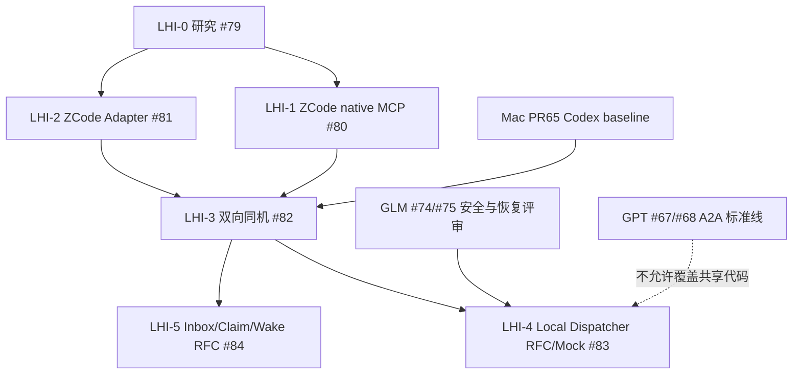

# Local Harness Interoperability (LHI) — GLM-5.3 开发执行工作线（2026-10-26）

**状态**：已建立 GitHub 任务包，**未开始本轮 LHI 实测**。本工作线是 [ADR 0005](../adr/0005-local-harness-interop.md) 的实施计划，加入 [2026-10-26 重规划](../INTEROP_REBASELINE_2026-10-26.md)，并平行于 #19 跨实体 P2、GPT #66–68 标准互操作以及 GLM #72–77 安全测试。本文没有批准真实模型调用、既有 GUI attach 或跨实体新窗口。

## 0. 给 GLM 的开工路由

1. 读取仓库根目录 [AGENTS.md](../../AGENTS.md)、[LLM_WORK_PACKETS](../LLM_WORK_PACKETS.md)、[ADR0004](../adr/0004-standards-first-agent-interop.md)、[ADR0005](../adr/0005-local-harness-interop.md)、[HARNESS_MATRIX](../HARNESS_MATRIX.md)、[本 LHI 文件](LHI_WORKSTREAM.md)。
2. 检查最新 GitHub main、open PR 和 #75 等 GLM 既有 CLAIM。**在同一个 GLM 会话/工作树完成 #75 之前，不要抢占新 LHI 分支。** 可由不同隔离工作树/另一个 Agent 实例领取不同互不相交的 Issue，但所有任务都须独立 CLAIM。
3. 若尚未开始 LHI，**首选 #79 LHI-0 文献/代码能力差距审查**（仅 docs），或者 #80 LHI-1 隔离 ZCode MCP outbound 真实探针（需事前确认被测机上的原生入口与测试授权）；不能跳过准备直接碰核心 router。
4. 每个任务独立 `glm53/lhi-... ` 分支、独立小 PR；先提交/推送测试脚本再运行 native fixture，正确区分实际 testedSource SHA、归档 commit SHA 和 CI head SHA。没有设备/版本则提交 runner/contract 与 NOT-RUN，绝不伪造 PASS。
5. 仅在用户确认与既有受控 native 测试范围内使用安装版；当前所有 LHI 工作限制为**same-host loopback / ephemeral private dirs / fake credentials / deterministic fixture**。
6. 任何想改动 `packages/runtime/**`、`packages/mcp-server/**`、`packages/storage/**` 或 #65 Codex fixture、#67/#68 A2A 代码必须先检查对应 PR 和 #74/#75 状态，并拆出设计审查/单独 PR；不能并发重写共享产品文件。

## 1. 架构结论与已验证基线

- **共用域与任务语义**：Node != Harness != Agent != Session != Task；local 和 remote 保持同一 idempotency fingerprint、durable event cursor、UNKNOWN 不自动重做、Native deny/cancel 终态。
- **现有单机路径（L0）**：两套 Gateway 都绑定 loopback，使用真实 libp2p Noise 配对以模拟两个被隔离节点。PR [#65](https://github.com/EchoTouch-moon/lan-agent-mesh/pull/65) Mac Codex→Mock/Codex 真实 MCP fixture 已有证据，**尚未作为当前 main 默认功能使用**。
- **目标本机路径（L4）**：一个 Gateway 接收不同本机 Harness 的单独 scoped MCP grants，经过本地 Policy/Router 调用 Gateway-owned 目标 Adapter；不需要远端人工 pairing，但绝不能绕过本机 caller 授权，也不可以把 `peer=self` 当成合法 trust。
- **已验证 ZCode 能力不是已实现 Adapter**：HARNESS_MATRIX 已记录 installed CLI 的 native create/resume/send/stream/cancel/deny fixture，但 ZCode 的 MCP **主动调用**和 Gateway-owned 正式入站尚未组合验证。
- **范围**：新创建的 Gateway-owned 受控会话；不向既有用户 GUI 注入消息、不导入默认用户帐号、不放权。

## 2. 六个独立 Issue 和强依赖

| 顺序 | Issue | 工作包 / owner | 文件范围 | 完成条件 |
|---|---|---|---|---|
| LHI-0 | [#79](https://github.com/EchoTouch-moon/lan-agent-mesh/issues/79) | GLM：本机项目研究、license/API 比较 | `docs/local/research/**` | pinned/cited 接口与功能矩阵，判断哪些机制能吸收 |
| LHI-1 | [#80](https://github.com/EchoTouch-moon/lan-agent-mesh/issues/80) | GLM：ZCode Native MCP 出站探针 | `scripts/lhi-zcode-mcp-*.mjs`、`docs/local/ZCODE_OUTBOUND_ACCEPTANCE.md`、对应 evidence | 真实 native tool call + tool result，拒绝/版本/清理证据 |
| LHI-2 | [#81](https://github.com/EchoTouch-moon/lan-agent-mesh/issues/81) | GLM：受控 ZCode Receiver Adapter | 新 `packages/zcode-adapter/**`、`docs/local/ZCODE_ADAPTER_CONTRACT.md` | 新会话/续会话/流/取消/权限默认拒绝/UNKNOWN synthetic + native local |
| LHI-3 | [#82](https://github.com/EchoTouch-moon/lan-agent-mesh/issues/82) | GLM：Codex↔ZCode 双向同机试验 | `scripts/lhi-codex-zcode-e2e.mjs`、`docs/local/evidence/dual-gateway/**` | 双方向 native MCP-origin→受控 native receiver，持久/取消/撤销负例 |
| LHI-4 | [#83](https://github.com/EchoTouch-moon/lan-agent-mesh/issues/83) | GLM：Local Dispatcher RFC + 后置 Mock PoC | `docs/local/LOCAL_DISPATCHER_RFC.md`、新 `packages/local-dispatch/**` | 先 RFC 获审查，再安全 Mock PoC，默认禁用与可回退 |
| LHI-5 | [#84](https://github.com/EchoTouch-moon/lan-agent-mesh/issues/84) | GLM：消息/Claim/Wake 语义 RFC | `docs/local/COORDINATION_PRIMITIVES_RFC.md` | 复用 existing Task/Session 可行性、冲突/循环/租期策略、非实现 |

**依赖图**：


LHI-0 和 LHI-1 可以做无冲突并行，但一个 GLM 工作树不要同时 checkout 两个分支。LHI-2 的进入条件是 native ZCode **受控入站**接口及版本/许可/风险评审清楚，不能仅因官方 MCP 文档支持出站就开始更改核心。LHI-3 必须依赖两条可归因 native 能力；LHI-4 不得以 SDK 模拟调用冒充真实 Harness 双向完成。

## 3. 各等级验收定义

- **L0-Config**：MCP server 出现在工具列表或 native API probe succeeds，仅证明配置/接口，不足以称发起/接收完整工作。
- **L1-Outbound**：**真实 installed** ZCode 发出带原生事件的 MCP invocation；关联参数、执行计数、工具结果、拒绝/清理；模型推理可用固定本地响应，不依赖云。
- **L2-Inbound**：真实 ZCode 接收方 `HarnessAdapter` 受限新会话执行与取消/UNKNOWN 完整归档；synthetic alone 不能当 native verified。
- **L3-Dual**：两个不同方向（Codex→ZCode、ZCode→Codex）分别具有 source-pinned native caller event + receiver task/session lifecycle 完整报告；没有则分方向列 partial/unknown。
- **L4-Local**：一 Gateway 两个不同本机 caller grants，经过身份与安全权限校验，执行受控 Mock；不需要虚拟 peer pairing。性能比较可作为后置指标，不允许以缩短 deadline/移除身份检查增加性能。
- **L5-Collaboration**：多 Agent ask/reply、resource claim、wake 的完整接口需要先完成 RFC、权限和循环阻断，不等于 LHI-3 Demo 已实现。

## 4. 同机与跨机统一权限与状态

`scoped local caller` 和 `scoped remote peer` 是不同安全主体。LocalTarget 与 RemoteTarget 应有不混淆的标记/类型，禁止用 `peer=self` 跳过 paired-peer 检查。所有调用应关联 caller/grant、agent/workspace alias、Gateway session、Task, originalEnvelopeFingerprint 和 deadline，且在 native 执行前持久化；新 native receiving adapter 仍通过原生拒绝权限，工作区仅 alias，真实路径本机注册。局域网能发现节点不等于信任；同一 OS UID 也不等于进程强制隔离，必须明确 threat model。

原已存任务重试/消息凭据失效/取消状态回归均属于验收，不因“localhost 很安全”跳过。Native process 不可确认已退出则 cleanup = uncertain，锁保留/UNKNOWN 不覆盖。是否开启本地 Agent 间的人工审批属于 #20/#21，**不允许 LHI 私设 allow 决策**。

## 5. 不与其它工作线争抢文件

| 已有工作 | LHI 避让规则 |
|---|---|
| GPT #66 PR #78 R0 上游审查 | LHI-0 仅研究本机 Agent Intercom/agent-peers 等，研究笔记单独存 `docs/local/research/**`，不编辑 `docs/research/upstream-locks.json` |
| GPT #67/#68 A2A | 不修改 `packages/a2a-bridge/**`，单 Gateway Local Dispatcher 的产品集成需要独立 RFC 和 review |
| GLM #75 durable task 恢复 | 已 CLAIM；除经审查独立新测试文件外，不同 PR 不并发改 `packages/storage/runtime` |
| GLM #74 MCP scoped auth | Local Dispatcher 不先修改 `packages/mcp-server/src`；先记录安全需求与测试，等待其回归 |
| Mac Codex PR #65 | 不覆盖 `scripts/codex-mcp-*`，LHI-3 自己编排受控复用，不宣称 PR65 已在 main 合并 |
| #19 跨实体 W3/B1/B2/B3 | LHI 全部 same-host；模拟两个节点的 pairing 不证明物理 Mac↔Win |
| #27 ZCode feasibility | 关联 Issue #81，但不自动关闭既有 ZCode 版本/跨平台验收范围 |

## 6. 交付格式（适合 LLM 直接使用）

```markdown
### CLAIM
taskId: LHI-0 | LHI-1 | LHI-2 | LHI-3 | LHI-4 | LHI-5
modelClaimed: GLM-5.3
baseSha: <exact 40hex, verify from current main>
branch: glm53/lhi-...
scope: <exact paths>
dependsOn: <URLs with actual PASS/blocked status>
testClass: docs | synthetic | native-local | dual-gateway-same-host
permissions: read-only research | isolated fixture loopback
stopConditions: <explicit>
expectedOutputs: <paths, tests, PR>
```

```markdown
### RESULT
testedSourceSha: <pre-committed 40hex>
headSha: <40hex>
sourceCleanBefore: true | false
nativeVersions: <Codex / ZCode OS / executable digest, or NOT-RUN>
testMatrix: <direction, native caller, native receiver, fixture, PASS/FAIL/UNKNOWN>
evidence: <source-linked JSON/markdown, hash, actual command exit codes>
negative: <scope deny, cancel, crash, unknown/no replay, cleanup>
CI: <4 jobs exact run URLs or unknown>
unverified: <exact scenarios>
mergeRecommendation: ready-for-review | blocked
rollback: <feature flag / no runtime effect / additive>
```

每个功能变更先 test/fixtures, 后运行实际任务。测试报错的退出码和原始失败记录保留。不许借用 #65 “仅 Codex 四个 local fixture tool approval”做不经审核的 ZCode 自动批准。

## 7. 如果用户未来想要“已有 GUI 会话聊天”

这是不同于本 LHI 的明确新需求。应先验证每个 Harness 是否公开允许 attach existing GUI / receiving external message / wake existing session 的受支持 API，并建立专门威胁模型。现阶段不承诺、不尝试、不把插件/renderer 私有 transport 当作官方开放接口。

